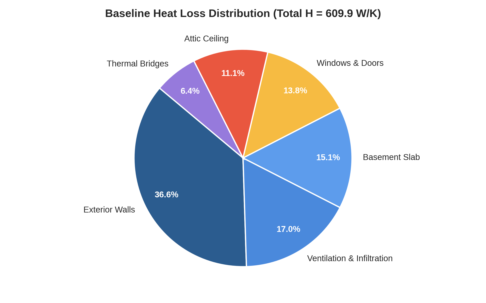
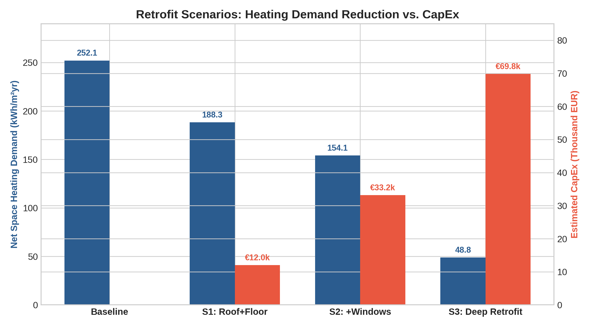

# Residential Building Energy Assessment & Deep-Retrofit Feasibility Study

A steady-state building physics and techno-economic simulation evaluating thermal envelope upgrades for a 1978 detached single-family residence ($180\text{ m}^2$) in Central Europe (Nuremberg/Bavaria climate zone).

## Overview & Objectives
Older residential stock built prior to modern thermal insulation ordinances accounts for a disproportionate share of space-heating energy demand and carbon emissions. This project models building geometry, layer-by-layer thermal transmittance, transmission and ventilation heat losses, and lifecycle economics across three staged renovation packages:
1. **Building Geometry & Thermal Zoning:** Quantifies conditioned floor area ($180.0\text{ m}^2$), heated air volume ($468.0\text{ m}^3$), and boundary-weighted envelope surface areas ($392.8\text{ m}^2$).
2. **Component $U$-Value Evaluation (ISO 6946):** Computes thermal resistance ($R = d/\lambda$) and transmittance ($U = 1/R_{\text{total}}$) for existing and upgraded walls, roof/attic ceiling, basement slab, and fenestration.
3. **Heat Loss & Demand Modeling (EN ISO 13789 & EN 12831):** Calculates transmission heat transfer ($H_T$), ventilation heat transfer ($H_V$), peak design heating load at $-12^\circ\text{C}$, and annual space-heating energy demand using effective Heating Degree Days ($\text{HDD}_{\text{eff}} = 3,100\text{ K}\cdot\text{d/yr}$).
4. **Scenario & Financial Benchmarking:** Compares capital expenditure (CapEx), utility savings (€0.12/kWh gas tariff), simple payback, 20-year Net Present Value (3% discount rate), and $\text{CO}_2$ abatement.

---

## Key Findings

* **Baseline Heat Loss Drivers:** Uninsulated exterior masonry walls account for **36.6%** ($223.3\text{ W/K}$) of total heat loss, followed by natural ventilation/infiltration at **17.0%** ($103.4\text{ W/K}$) and the uninsulated basement slab at **15.1%** ($92.1\text{ W/K}$).
* **Highest Cost-Effectiveness (Scenario 1):** Insulating the attic ceiling (240 mm mineral wool) and basement ceiling (100 mm PIR) requires only **€12,000** CapEx, reduces heating energy by **25.3%**, and delivers the fastest simple payback (**7.4 years**) and highest unsubsidized 20-year NPV (**+€12,102**).
* **Window Replacement Economics (Scenario 2):** Replacing double glazing with triple-glazed low-E units ($U_w = 0.80\text{ W/m}^2\text{K}$) without insulating the exterior walls extends simple payback to **13.3 years** due to high window CapEx (€21,155) relative to remaining wall losses.
* **Deep Retrofit & Heat-Pump Readiness (Scenario 3):** Adding 160 mm exterior wall insulation (ETICS) and mechanical ventilation with heat recovery ($\eta_{\text{HR}} = 82\%$) cuts final heating energy demand by **80.6%** (from $296.6$ to $57.4\text{ kWh/m}^2\text{yr}$ final / $48.8\text{ kWh/m}^2\text{yr}$ net) and drops peak design heating load from **$19.52\text{ kW}$ to $3.78\text{ kW}$**, enabling low-temperature heat pump electrification.

---

## Results Summary
## Visual Analysis



| Scenario | $H_T$ ($\text{W/K}$) | $H_V$ ($\text{W/K}$) | Peak Load ($\text{kW}$) | Net Demand ($\text{kWh/m}^2\text{yr}$) | Energy Saved | CapEx (€) | Simple Payback | 20-Yr NPV (€) | $\text{CO}_2$ Saved ($\text{t/yr}$) |
| :--- | :---: | :---: | :---: | :---: | :---: | :---: | :---: | :---: | :---: |
| **0. Baseline (1978)** | 506.4 | 103.4 | 19.52 | 252.1 | — | — | — | — | — |
| **1. Quick Wins (Roof + Floor)** | 360.2 | 95.5 | 14.58 | 188.3 | 25.3% | €12,000 | 7.4 yrs | +€12,102 | 2.71 |
| **2. S1 + Triple Windows** | 293.2 | 79.6 | 11.93 | 154.1 | 38.9% | €33,155 | 13.3 yrs | +€3,890 | 4.17 |
| **3. Deep Retrofit (+ETICS + MVHR)** | 89.3 | 28.8 | 3.78 | 48.8 | 80.6% | €69,817 | 13.5 yrs* | +€7,025* | 8.65 |

*\*With a 20% federal building envelope subsidy (BEG), Scenario 3 net CapEx drops to €55,854, reducing simple payback to 10.8 years and raising 20-year NPV to +€20,988.*

---

## Methodology & Governing Equations

* **Layer Thermal Transmittance (ISO 6946):**
  $$U = \frac{1}{R_{si} + \sum_{i} \frac{d_i}{\lambda_i} + R_{se}}$$
* **Transmission Heat Transfer Coefficient (EN ISO 13789):**
  $$H_T = \sum_{i} (U_i \cdot A_i \cdot b_{u,i}) + \Delta U_{\text{TB}} \cdot A_{\text{env}}$$
* **Ventilation Heat Transfer Coefficient:**
  $$H_V = 0.34 \cdot \left[n_{\text{inf}} + n_{\text{vent}} \cdot (1 - \eta_{\text{HR}})\right] \cdot V$$
* **Design Heating Load (EN 12831):**
  $$\Phi_{HL} = \frac{(H_T + H_V) \cdot (T_{\text{int}} - T_{\text{ext}})}{1000} \quad [\text{kW}]$$

---

## How to Run

1. Install dependencies:
   ```bash
   pip install numpy pandas matplotlib
